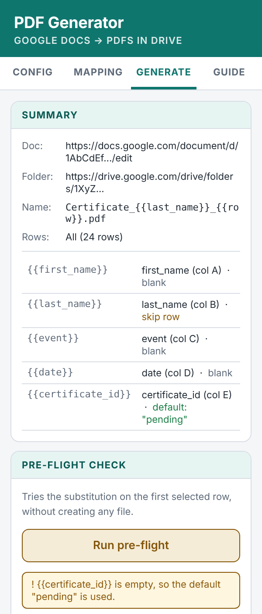

# Sheets to PDF Letters

Turn a Google Sheet and a Google Doc template into a folder of personalised PDFs.

You write a letter once, with placeholders like `{{first_name}}`. Every row of your sheet becomes one PDF, with the placeholders replaced by that row's values. It works for certificates, invitations, formal letters, attendance confirmations, offer letters, and anything else you would otherwise copy and paste by hand.

Everything runs inside your own Google account. No server, no subscription, no data leaves Google.



## What you get

- A sidebar inside Google Sheets that guides you step by step: template, destination, column mapping, check, generate.
- Placeholders work in the body, header, footer and tables of the Doc.
- A choice for each field: leave empty cells blank, use a default text, or skip that row.
- A **pre-flight check** that shows exactly what one row will look like before you create anything.
- PDFs are made a few at a time with a progress bar, and you can stop whenever you like.
- Dates and numbers appear as they look in your sheet.
- File names built from your data, for example `Certificate_Lovelace_1.pdf`. If a name already exists in the folder, `_2`, `_3` and so on are added, so nothing is overwritten.
- Special characters in your data (`$`, `\`, accents, quotes) are inserted exactly as written.

## Set it up (once, about 10 minutes)

You do not need to know how to code. You will copy and paste two files.

**1. Get the two files.** On this page, open `Code.gs` and `Sidebar.html`, and keep them handy (the "Raw" button, or the copy icon, gives you the plain text).

**2. Open the script editor from your sheet.** In the Google Sheet you want to use, click **Extensions**, then **Apps Script**. A new tab opens with a file called `Code.gs`.

**3. Paste the first file.** Click inside `Code.gs`, select everything (Ctrl+A, or Cmd+A on a Mac), delete it, and paste the content of this repository's `Code.gs`.

**4. Add the second file.** In the left column, next to **Files**, click the **+** and choose **HTML**. Type the name `Sidebar` (just that, Google adds `.html`). Select everything in the new file, delete it, and paste the content of `Sidebar.html`.

**5. Save.** Click the disk icon (or press Ctrl+S / Cmd+S). You can close the Apps Script tab.

**6. Reload your sheet.** Refresh the browser tab. After a few seconds a new menu called **PDF Generator** appears next to Help.

**7. Allow it, the first time.** Click **PDF Generator**, then **Open configurator**. Google asks for permission:

- Choose your account.
- You will probably see **"Google hasn't verified this app"**. This is normal: it is your own private script, and nobody has submitted it to Google for review. Click **Advanced**, then **Go to (your project name) (unsafe)**, then **Allow**.
- Google lists broad permissions for Sheets, Docs and Drive, because that is how Google describes this kind of access for any script. The tool uses them only to read your sheet, copy your template, and save PDFs in the folder you choose. You can read every line of the code to check.

After that, the sidebar opens. From now on you only need steps 8 onwards.

## Use it

**8. Prepare the template.** Create a Google Doc with your letter. Wherever something changes from person to person, write a placeholder in double curly braces. There is a ready-made text in [`examples/template-text.md`](examples/template-text.md) that you can paste into a new Doc to try.

- Use a real Google Doc. If you have a Word file, upload it to Drive, open it, and choose **File, then Save as Google Docs**.
- Give each placeholder a simple name: letters, numbers and underscores, like `{{last_name}}`. Capital letters count: `{{Country}}` and `{{country}}` are different.
- You can repeat the same placeholder as many times as you like, and use them in the header, footer and tables.
- To change how a value looks (bold, font, size), format the placeholder itself in the Doc. The value normally takes on that formatting.
- You only need to be able to open the Doc yourself. You do not have to share it with anyone.

**9. Prepare the sheet.** Row 1 holds the column headers. Each row after that becomes one PDF. You can import [`examples/participants.csv`](examples/participants.csv) (File, then Import, then Upload) to try the tool with sample data.

**10. Open the sidebar.** Click **PDF Generator, then Open configurator**.

**11. Config tab.**
- Paste the link of your Doc template and click **Detect placeholders**. The tool lists what it found.
- Paste the link of the Drive folder where the PDFs should go (you need to be able to add files to it).
- Choose a file name pattern, for example `Certificate_{{last_name}}_{{row}}`. `{{row}}` is the row number.
- Choose all rows, or a range.

**12. Mapping tab.** For each placeholder, pick the column it comes from. Columns whose name looks like the placeholder are pre-selected. Then decide what happens if that cell is empty:
- **Leave blank**: the placeholder disappears.
- **Use default**: a fallback text is used, for example "Dear colleague".
- **Skip row**: no PDF is made for that row. Use it for things the letter cannot do without, like a last name.

**13. Generate tab.**
1. Click **Run pre-flight**. Read the values and the warnings. Fix anything odd.
2. Click **Generate PDFs**. Watch the progress bar. The files appear in your Drive folder.
3. Open the first PDF and check it before sharing anything.

Try 2 or 3 rows first (choose **Range**), then run the rest.

## If something does not work

| What you see | What to do |
|---|---|
| No **PDF Generator** menu | Reload the sheet and wait a few seconds. Check that you pressed Save in the script editor. |
| The sidebar is blank or shows an error about `Sidebar` | The second file must be named exactly `Sidebar` (it shows as `Sidebar.html`). |
| "Cannot open the Doc" | Check the link, that you can open the Doc, and that it is a Google Doc (not a Word file or a PDF). |
| "No placeholders found" | Placeholders need two curly braces on each side, typed as normal text in the Doc. Try **PDF Generator, then Inspect template structure (advanced)** to see what the tool can read. |
| A placeholder stays in the PDF | It is not mapped, or the spelling or capitals differ between the Doc and your mapping. |
| A date looks different from the sheet | The tool copies what the cell displays. Change the cell's format in the sheet. |
| Permission or "not found" error on the folder | Check the folder link and that you can add files to that folder. |
| "Service invoked too many times" or a daily limit message | Google limits how much a script can do per day, and the limits differ between personal and Workspace accounts. Wait, then continue with **Range** from the row where it stopped. See Google's "Apps Script quotas" page. |
| "Another generation is still running" | Wait for the other run to finish (it may be open in another tab), then try again. |
| Files called `_temp_pdf_gen_...` in the folder | Normally they are removed automatically. If a run was interrupted, you can delete them. |

## Make it yours

The tool is meant to be adapted. Everything you may want to change is in one of two places.

### The look: one block at the top of `Sidebar.html`

Find the block marked **THEME**. It is a list of named colours. Change a value and the whole sidebar follows. Colours are hex codes, for example `#0F766E`. Any colour picker will give you one.

| Name | What it controls |
|---|---|
| `--brand` | Main colour: header, active tab, main button |
| `--brand-dark` | Same colour, slightly darker, for hover |
| `--brand-tint` | Very light version, behind section titles |
| `--on-brand` | Text colour on top of the main colour (white or near black) |
| `--accent`, `--on-accent` | Step numbers and the focus outline |
| `--ok`, `--warn`, `--error` and their `-bg` versions | Success, warning and error messages |
| `--text`, `--muted`, `--border`, `--page`, `--surface` | Greys: text, secondary text, lines, background, cards |
| `--radius` | Roundness of corners (`0` for square, `16px` for very round) |
| `--font`, `--mono` | Typeface for text and for placeholders |

Two quick recipes you can paste over the matching lines:

```css
/* Warm */
--brand: #B4532A;  --brand-dark: #8F3F1D;  --brand-tint: #FBEDE6;
--accent: #3B82A0; --on-accent: #FFFFFF;

/* Slate */
--brand: #334155;  --brand-dark: #1E293B;  --brand-tint: #E8ECF1;
--accent: #F59E0B; --on-accent: #1F2933;
```

Keep enough contrast between a colour and the text on it (light text on a dark colour, or the reverse). If you use another organisation's colours or logo, check that you are allowed to.

To add a logo, put an image tag inside the `header` block of the page, for example ``. The image has to be reachable on the web, or embedded as a data link.

### The words

| To change | Where |
|---|---|
| Name shown in the sidebar header and its subtitle | `Sidebar.html`, in the `header` block (look for `PDF Generator`) |
| Name of the menu and the sidebar title | `Code.gs`, `SETTINGS` block at the top |
| The short instructions window | `Code.gs`, function `showInstructions` |
| Labels, hints and the Guide tab | `Sidebar.html`, plain text inside the page. Translating the tool means translating these texts and the messages in `Code.gs`. |
| Example texts (placeholders, file names) | `Sidebar.html`, inputs' `placeholder="..."` and the Guide tab |
| Default PDF name when none is given | `Code.gs`, function `buildFileName_` (currently `Letter_{{row}}`) |
| How many rows are sent per step | `Sidebar.html`, `CHUNK_SIZE` at the start of the script |

After any change, paste the new version into the Apps Script editor, save, and reload your sheet.

## Good to know

- **Your data stays in your Google account.** The script reads your sheet, copies your template and writes PDFs to your folder. It sends nothing anywhere else.
- **Large batches take time.** Each PDF takes a few seconds. The tool works in small steps so it never hits Google's time limit, and you can stop and continue later.
- **The template is never changed.** Each PDF is made from a temporary copy, which is deleted right after.
- **Images in the template** (logos, signatures) are kept, because the PDF is made from a copy of your Doc.

## For developers

- `Code.gs` is the server side (Apps Script). `Sidebar.html` is the sidebar (plain HTML, CSS and JavaScript, no libraries). `appsscript.json` is the manifest, only needed if you use [clasp](https://github.com/google/clasp).
- `node tests/code.test.js` runs checks on the server logic (placeholder replacement, skipping, file names, batching, clean-up) against small fakes of Sheets, Docs and Drive. No installs needed.
- The checks use simulated Google services, so they cannot prove how real Docs behave. Try the tool with a few rows on your own Doc before relying on it.
- Placeholders are replaced by inserting and deleting text directly, not with `replaceText`, because `replaceText` treats `$` and `\` in the value as instructions.

## How this was made

This tool was written with the help of an AI assistant (Claude) by someone who is not a software engineer, and then reviewed and tested step by step. Bug reports and suggestions are welcome.

## Licence

[MIT](LICENSE). You can use, change and share it, including for work, as long as you keep the licence notice.
